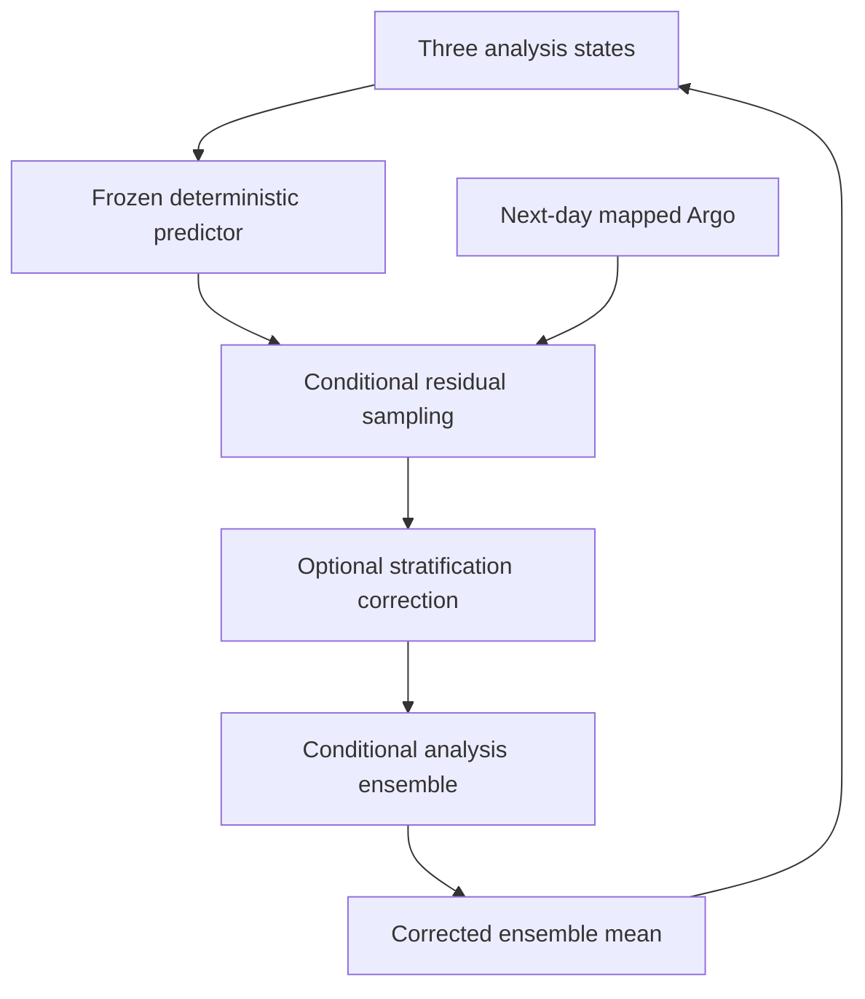

# Argodiff

_Argo-guided residual diffusion ensembles for cyclic prediction of global ocean temperature and salinity._

---

## 📋 Overview

Argodiff combines a frozen deterministic ocean predictor with conditional residual diffusion. Daily Argo observations guide the reverse-denoising process, and optional stratification constraints control physically inconsistent temperature-salinity profiles. The corrected ensemble mean supplies the next day's analysis history.

This repository accompanies **Argo-guided residual diffusion with stratification constraints for cyclic prediction of global ocean temperature and salinity**. It includes model training, rollout fine-tuning, observation preprocessing, cyclic evaluation, physical diagnostics, and manuscript figure/table reconstruction. The Python package retains the name `diffargo` for compatibility with the archived experiments.

| Component | Implementation |
| --- | --- |
| Deterministic background | U-Net predictor and rollout fine-tuning |
| Residual uncertainty | Conditional residual diffusion |
| Observation guidance | Argo-loss gradients during denoising |
| Physical correction | Stratification-aware constraints |
| Spread calibration | Channel- and cycle-day anomaly scaling |
| Comparisons | Deterministic, diffusion, guidance and simple update baselines |

## 🔄 Daily cycling



The mean correction uses paired guided-minus-unguided draws. Ensemble members are regenerated around a common cycling history rather than propagated as independent long-horizon trajectories. Nudging and diagonal-Gaussian updates are comparison baselines; they are not the observation-guided diffusion sampler.

## 🚀 Installation and quick start

The archived environment uses Python 3.11. Install a PyTorch build appropriate for your CPU/GPU, then run from the repository root:

```bash
python -m pip install -r requirements-release.txt
python -m pip install -e .
python tools/verify_bundle.py .
```

The companion data archive is maintained separately. Extract it next to this repository as `../diffargo_data`, then reproduce the manuscript tables and figures:

```bash
python tools/verify_bundle.py ../diffargo_data
python tools/reproduce_tables.py --data-root ../diffargo_data --output-dir outputs/tables
python tools/reproduce_figures.py --data-root ../diffargo_data --output-dir outputs/figures
```

Use a new output directory for figure reconstruction. Figures 2-8 and Tables 2-6 are reconstructed from supplied numerical sources; Figure 1 is a schematic. The data record's DOI will be added when assigned. No dataset DOI is implied by this repository.

## ⚙️ Data and configuration

The model uses a global 1.5-degree grid with 15 depth levels and 30 temperature/salinity channels. Model execution requires the preprocessed GLORYS archive and mapped daily Argo guidance/holdout inputs described in the [input data contract](docs/INPUT_DATA_CONTRACT.md).

```bash
python tools/configure_release.py --data-root ../diffargo_data \
  --glorys-root /path/to/reanalysis_31year --argo-root /path/to/Argo --install-models
```

This configures storage roots and installs trusted released checkpoints, normalization files and calibration artifacts at project-relative locations. Different existing model artifacts are not overwritten. The three checkpoints and experiment outputs belong in the companion data archive, not Git history.[^1]

GLORYS is obtained through Copernicus Marine Service; Argo has a separate upstream data-access route.[^2][^3] The exact preprocessed archive is required for a model rerun. The original GLORYS coarsening provenance and the particular Argo export's temperature/QC convention are described in the input contract; do not mark unresolved source declarations as confirmed without verification.

## 🧪 Training and fine-tuning

Run the stages sequentially in a clean training checkout. Do not overwrite installed reference checkpoints.

```bash
python compute_stats.py --config configs/hpc_direct.yaml
python train_direct.py --config configs/hpc_direct.yaml
python train_rollout.py --config configs/hpc_rollout_h7.yaml
python compute_residual_stats.py --config configs/residual_diffusion.yaml \
  --deterministic-checkpoint runs/hpc_rollout_h7/checkpoint_best.pt \
  --output artifacts/residual_stats_rollout_h7.npz
python train_residual_diffusion.py --config configs/residual_diffusion.yaml \
  --deterministic-checkpoint runs/hpc_rollout_h7/checkpoint_best.pt \
  --residual-stats artifacts/residual_stats_rollout_h7.npz \
  --output-dir runs/residual_diffusion_guided --epochs 40 --batch-size 1 --num-workers 4
python train_residual_rollout.py
```

The reference settings include seven-day deterministic rollout fine-tuning and residual rollout fine-tuning. See [training and evaluation](docs/TRAINING_AND_EVALUATION.md) for recorded settings, preprocessing entry points and experiment orchestration.

For Slurm, activate your environment, adapt the resource request, and submit each stage after its prerequisite finishes:

```bash
sbatch scripts/submit_pipeline.slurm direct
sbatch scripts/submit_pipeline.slurm rollout
sbatch scripts/submit_pipeline.slurm residual_stats
sbatch scripts/submit_pipeline.slurm residual
sbatch scripts/submit_pipeline.slurm residual_rollout
```

The portable wrapper specifies no site-specific account or partition. On systems that use `yhbatch`, substitute it for `sbatch`. Original fingerprint-referenced scheduler files are retained as provenance assets.

## 📊 Testing and evaluation

```bash
python -m pytest -q tests/test_direct.py tests/test_residual_rollout_finetune.py \
  tests/test_spread_calibration.py test_ems_v1.py test_ems_lowmem.py test_ems_sections_2d.py
python -m pytest -q tests/test_residual_rollout_end_to_end.py
```

The packaged snapshot passed 34 local tests, including synthetic NetCDF training, checkpoint saving and two-day cycling. Figures 2-8 were regenerated, and reconstructed Tables 2-6 matched the manuscript snapshot. These checks are documented in [release validation](RELEASE_VALIDATION.md); they are distinct from full GPU training or a new 90-day ocean experiment.

To prepare an archived 90-day case in a new location:

```bash
python tools/replay_case.py --data-root ../diffargo_data \
  --recipe ../diffargo_data/experiments/ems_v1_legacy/cases/validate/nominal/selected/m50_k50/winter/20261006/attempt_001/recipe.json \
  --argo-root /path/to/Argo --output-dir outputs/replay_sa_winter
```

This is a dry run unless `--run` is supplied. Supply and verify all real input archives before execution. Historical protocol checks remain enabled; protocol-bound quick-screen cases require a fresh runtime context rather than altered completion markers.

## 📦 Repository layout

| Path | Contents |
| --- | --- |
| `diffargo/` | Model, data loading and diffusion primitives |
| `train_*.py` | Deterministic/residual training and rollout fine-tuning |
| `ems_*.py`, `oe_*.py` | Cyclic experiments, observation guidance and diagnostics |
| `prepare_*.py`, `argo_*.py` | Observation inventory, mapping and guidance inputs |
| `configs/` | Portable scientific configurations |
| `figures/`, `tools/` | Figure/table reconstruction and release utilities |
| `scripts/` | Portable Slurm entry point |
| `tests/`, `test_ems_*.py` | Unit, regression and synthetic integration tests |
| `docs/`, `provenance/` | Input contract, experiment settings and source records |

## 🔍 Result provenance

The companion archive distinguishes the revised Figure 4 depthwise RMSE summary from archived daily scores. The revised SA-Diff aggregate temperature/salinity RMSE is 0.81881 degrees C / 0.19859, corresponding to reductions of 3.34% / 0.91%. Figure 2 and probabilistic diagnostics retain their archived daily-score sources. No revised daily series or CRPS is inferred from aggregate RMSE.

The main 2019 evaluation is a development evaluation whose first 30 days overlap parameter selection. Planned test-year configuration fields are not evidence that those experiments were completed. These version and evaluation boundaries are preserved in the companion data documentation.

## 📚 License and citation

Original code and associated documentation are licensed under **MIT**; see [LICENSE](LICENSE), [rights](RIGHTS.md) and [third-party notices](THIRD_PARTY_NOTICES.md). Original companion data/model artifacts use CC BY 4.0. Upstream GLORYS/Argo material and dependencies retain their own terms.

See [citation instructions](docs/CITATION_TEMPLATE.md). Add the actual data DOI and article identifier when assigned; no publication or repository DOI is fabricated. Scientific Agent Skills supported documentation and evidence checks, as recorded in those instructions.

[^1]: GitHub Docs. About large files on GitHub. https://docs.github.com/en/repositories/working-with-files/managing-large-files/about-large-files-on-github
[^2]: Copernicus Marine Service. Global Ocean Physics Reanalysis. https://doi.org/10.48670/moi-00021
[^3]: Argo programme. Data access. https://argo.ucsd.edu/data/
